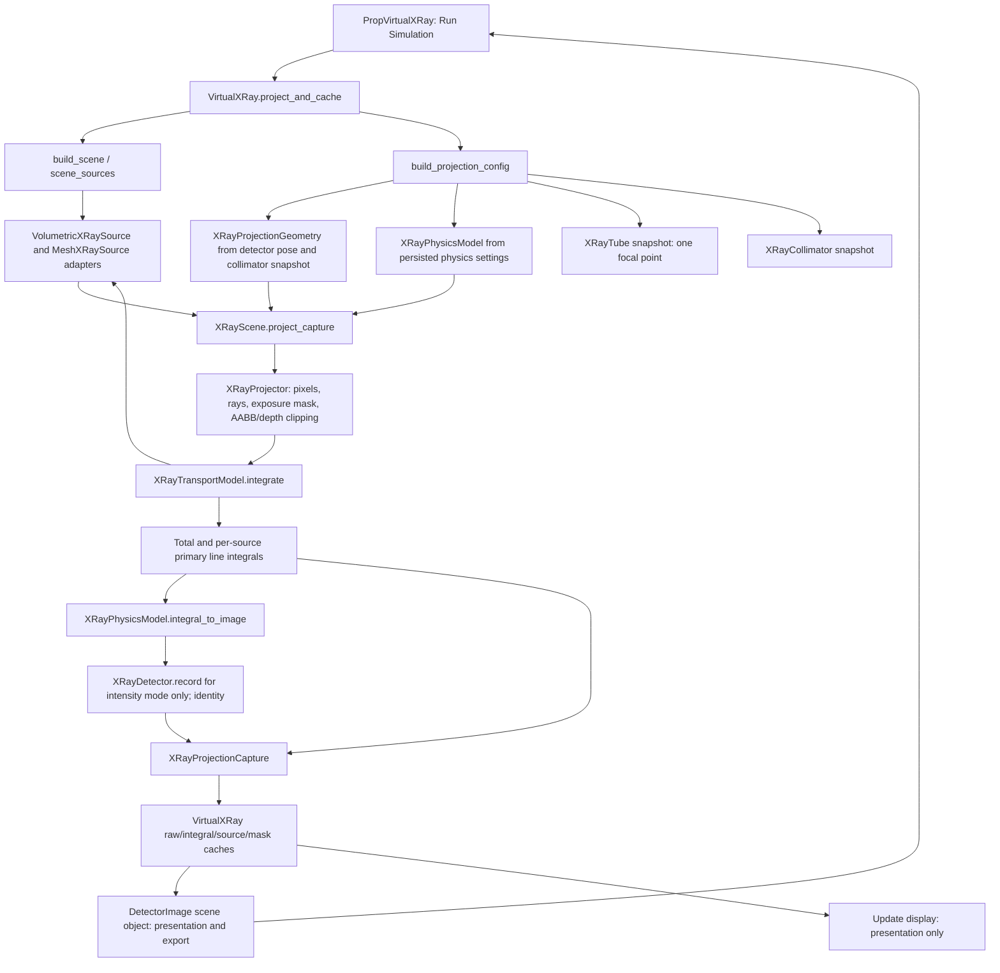

# virtRTG 0.6.4 Architecture and Integration Audit

Audit date: 2026-11-05
Scope: accepted plugin state through 0.6.3; inspection only. No production code, benchmarks, baselines, or runtime behavior were changed.

## Executive summary

The 0.6.1–0.6.3 boundaries are coherent as staged value-object and computational seams, and the accepted numerical path remains localized in the existing projector/source/physics code. The 0.6.2 transport extraction preserved its prepared-ray contract and has frozen-array regression evidence. The 0.6.3 detector seam is intentionally identity-only and does not claim calibrated detector physics.

There are two material architectural limitations, neither a demonstrated current numerical defect:

1. `XRayProjectionConfig` carries tube and collimator snapshots, but the projector currently consumes geometry and physics only. Tube and collimator configuration therefore act as construction facades, not independent runtime collaborators. Their effective current settings are still encoded in `XRayProjectionGeometry`.
2. Projection caches have no dependency signature or freshness state. A run explicitly snapshots current inputs into arrays, but editing sources, transforms, acquisition settings, or physics leaves the previous result available for display/export. This is consistent with explicit “Run Simulation” semantics, but the cache cannot establish that it corresponds to the current scene and must not be treated as automatically current.

No verified existing defect was found in the accepted numerical pipeline or cache array round-trip. Configuration changes are picked up on the next explicit projection because scene sources and config are rebuilt for each call. Transform handling is relative to the `VirtualXRay` frame and is included in newly built sources. Serialization preserves effective acquisition settings and cache arrays, but does not bind a saved cache to a configuration fingerprint.

The architecture is sufficiently coherent to proceed without another broad refactor. For the next stage, do not add work solely to fill a version. If nonideal response or multiple focal samples are selected, first define and test the incident-signal/ray-sample contracts and make the existing component snapshots participate in execution. An attenuation-source adapter can be explored through the existing `XRaySampleSource` interface without changing the numerical projector.

## Evidence and method

Verified by direct inspection of the checked-out implementations, accepted design/baseline/handoffs, call sites, tests, serialization paths, and benchmark runner. Inferences and prospective consequences are labeled as such. No tests were run: the task is an inspection and planning report, and accepted 0.6.2/0.6.3 handoffs already record numerical and suite evidence. Relevant accepted commits in the nested plugin history are `8b7ff41` (0.6.1), `c9830e2` (0.6.2), and `2738c0c` (0.6.3).

## Current architecture and end-to-end workflow

### Verified execution path

`PropVirtualXRay.on_run_simulation()` calls `VirtualXRay.project_and_cache()`. That calls `project_capture()`, which builds a fresh scene and a fresh `XRayProjectionConfig`, and calls `XRayScene.project_capture()`. The scene creates an `XRayProjector` for its source adapters. `XRayProjector.project_capture()` currently forwards only effective geometry, physics model, and reference transform to `project()`; the config's tube, collimator and presentation fields are not consumed there.

`XRayProjector.project()` creates detector pixel centers and either cone rays from the configured source point or parallel rays from detector pixels. It computes an optimized rectangular exposure mask from the beam fields embedded in geometry, intersects rays with the aggregate scene AABB, applies ray or planar depth clipping, then passes the prepared full-detector ray arrays and hit indices to `XRayTransportModel.integrate()`. Transport dispatches direct adapters and sampled adapters. It returns primary integrals and per-source maps. The projector applies `XRayPhysicsModel.integral_to_image()` to the total; in intensity mode only, that result passes through the configured/default identity detector. It separately converts per-source integrals for diagnostics and assembles capture arrays, mask and optional statistics.

`VirtualXRay.project_and_cache()` stores total line integrals, detector image, source contributions and exposure mask, then projects annotations as separate overlay metadata. The GUI synchronizes the image into a `DetectorImage` object. `Update display` reads cached output and presentation settings; it does not rerun transport. `DetectorImage` owns display mapping and image presentation state, not acquisition physics.

### Scene transforms and source ownership

`VirtualXRay` traverses descendant mesh and volume objects, skipping nested `VirtualXRay` sub-scenes. It constructs source adapters with transforms relative to its own frame, including selected motion-frame transforms. The projector's `reference_transform` is identity for this plugin-created scene because source geometry and child transforms are already expressed relative to the `VirtualXRay` frame. The `VirtualXRay` object's global transform is used for scene/gizmo relationships and annotation projection, rather than applying it a second time to local projection geometry.

The source adapters own source-specific sampling/integration configuration and local acceleration caches (for example mesh BVH and projected intersection stack). `XRayTransportModel` owns dispatch and sampled integration orchestration for one projector. `XRayProjector` owns ray setup, mask and clipping, conversion/capture assembly. `XRayScene` is a short-lived source collection/facade. `VirtualXRay` owns user-editable configuration, source gathering, orchestration and runtime result caches.

## Component responsibility matrix

| Component | Current responsibility and inputs/outputs | Ownership, dependencies, and configuration | Boundary assessment and future impact |
|---|---|---|---|
| `XRayTube` / `FocalSpotSamples` | Immutable snapshot for weighted focal positions, weights, explicit frame, optional tube rotation and optional energy. Current builder creates exactly one sample at `source_position_ref`. | Built by `VirtualXRay.build_tube_model()` from persisted source position and `physics_source_energy_kev`; travels on `XRayProjectionConfig`. No scene ownership or serialization of an independent tube pose/sample distribution. | Validation/value-object seam is sound. Runtime projector does not consume it; N=1 rays still come from geometry. Multiple samples require a ray-batch contract and signal aggregation; the data class alone does not implement them. Energy duplicates the current physics source-energy setting if both are populated. |
| `XRayCollimator` | Immutable ideal angular rectangular field snapshot; transmission helper accepts directions from a shared point. | Built from `directional_beam_geometry` and `physical_collimation_enabled`. Geometry construction also embeds beam geometry and enable flag. | Currently duplicated as a config object plus geometry fields. The projector uses geometry's vectorized mask, not `XRayCollimator.transmission_for_directions()`. This is a staged facade; current source of truth remains `VirtualXRay` fields. Positioned aperture / independent-origin collimation is explicitly outside this contract. |
| `XRayProjector` | Builds pixel coordinates/rays, rectangular exposure mask, scene-bound and depth clipping; delegates integration; maps total/source integrals to images and builds capture/stats. | Created by `XRayScene` from current adapters; consumes geometry, physics and reference transform. Owns default `XRayDetector`. | Still deliberately broad: geometry preparation, legacy signal conversion, detector call and capture assembly remain together. This is consistent with the accepted 0.6.2 staged extraction. Extensions to ray origins/multiple samples or new detector semantics will touch it. Avoid moving more without a concrete contract need. |
| `XRayTransportModel` | Classifies source adapters into direct and marched groups, accumulates primary line integrals, work counts, timings and per-source diagnostics. Input is a prepared/clipped batch; output arrays are flattened C-order detector maps. | Constructed with the projector and retains the source list by reference plus an identity-to-index map. Uses source and physics-model interfaces. | Useful narrow seam; not a whole acquisition transport owner. `hit_mask` and `hit_indices` consistency is guaranteed by projector, not validated by transport. Existing test covers direct prepared-ray dispatch; end-to-end frozen comparisons cover sampled operation. Internal extension should preserve batch semantics and ordering. |
| `XRayPhysicsModel` | Converts scalar inputs (including HU/material mappings) to attenuation, and converts integrated attenuation to legacy integral/intensity output with floor and optional distance gain. | Built from `VirtualXRay` physics settings and per-source overrides; passed to adapters and projector. | Two related stages remain together. This is legacy compatibility and not a current correctness issue. HU/material interpretation belongs before/in attenuation mapping; it is not a detector responsibility. Moving `integral_to_image()` requires explicit compatibility characterization. |
| `XRayDetector` | Identity `record(incident_signal)`; returns the same object unchanged. | Default instance owned by projector unless injected. No geometry/settings/state. Called only for total intensity-mode output; integral mode and per-source diagnostic conversions bypass it. | Real seam but no physical response yet. A nonidentity implementation needs a meaningful incident-signal contract and decisions about per-source diagnostics; current simplified intensity is not calibrated fluence or counts. |
| `DetectorImage` | Scene object holding image data and presentation state; performs display mapping and supports image/package import/export and synchronization from `VirtualXRay`. | Created/synchronized by GUI, caches image data separate from `VirtualXRay`, serialized as a distinct node/package payload. Depends on virtual X-ray cache only when synchronizing. | Presentation separation is clear. It should remain outside transport and detector response. Package cache persistence does not establish provenance or freshness against source/acquisition configuration. |

## Configuration ownership and propagation

### Source of truth and snapshot lifecycle

Persisted/editable settings reside on `VirtualXRay` and source scene objects. Each projection call reconstructs source adapters (including current relative transforms, enabled state, scalar overrides, volume backend, mesh mode and shell thickness), geometry, physics model, tube/collimator snapshots and quality profile. This makes a new explicit run observe current state; there is no shared long-lived acquisition config object.

Geometry fields cover detector pose, dimensions, pixel spacing, projection mode source/direction, depth restrictions, beam geometry and collimation enable. Physics config covers HU-to-attenuation/material behavior, energy parameters, output mode, intensity floor and distance scaling. Per-object source settings cover source enablement, scalar map adjustments, attenuation multiplier, interpolation/fill/preprocessing, and volume/mesh backend choices.

The tube and collimator fields on `XRayProjectionConfig` are snapshots built from these authoritative fields. They are not independently serialized, and no separate tube pose or independent focal samples are user-configurable. `XRayTube.energy_kev` currently reflects the same `physics_source_energy_kev` field that configures the physics model.

### Transform and change propagation

Source transforms are recalculated when adapters are constructed. Thus scene hierarchy or transform changes affect the next run. Detector/source/depth/beam edits affect rebuilt geometry. Physics edits affect a rebuilt physics model. Source object data/config changes affect new adapters. Nothing automatically recomputes the prior cache on edit; the GUI's explicit simulation action is the computation boundary.

Serialization writes the effective `VirtualXRay` geometry/physics/source defaults and separate `DetectorImage` cache/image payloads. Cache payloads preserve raw, line-integral and per-source arrays plus exposure mask where present. Restoring a line-integral-only cache can convert it using the current `VirtualXRay` physics and geometry. No saved cache configuration signature is checked against currently loaded settings or scene contents.

## Cache and invalidation findings

| Question | Observed behavior | Assessment |
|---|---|---|
| Are snapshots fresh per run? | Yes. Scene/config are rebuilt along `project_capture()` for every explicit run. | Correct for currently supported settings. |
| Is there a reusable projection memoization cache? | No. `last_*` fields are result storage; a run recomputes. Source mesh acceleration caches are separate and local to adapters. | No reuse guarantee to audit; unchanged input does not skip projection. |
| Does a transform affect a newly run projection? | Yes. Relative transforms are recomputed while source adapters are built. | No missed transform dependency found in the explicit-run path. |
| Are tube/collimator/detector settings represented in actual execution? | Current source point and rectangular beam are encoded in geometry. Tube/collimator config fields are not independently consumed. Detector response is consumed only as identity for total intensity. | Correct for currently implemented features; missing contracts for independent future parameters. |
| Can cache freshness be established after settings or source edits? | No. Cached arrays remain available until another run/import; no dirty flag, input revision or fingerprint. | Architectural debt; can mislead users if cached results are assumed current. Explicit Run/Update display labels currently distinguish compute from display, but do not state staleness. |
| Does persistence preserve arrays and effective projection settings? | Yes, as separate configuration and cache payloads. Import/package round trips have tests for arrays and overlays; scene tests cover settings. | Array persistence is supported. Cache provenance is not. A restored raw image remains a saved result even when config differs. |
| Do presentation changes alter raw projection? | No. DetectorImage presentation is applied after cached acquisition output. | Correct separation. |

No ordinary cache invalidation mechanism is required for the current explicit-run workflow because the result is a user-visible snapshot, not an automatic memoized answer. A freshness marker or fingerprint becomes justified if UI behavior starts implying that cached output is current, if automatic reuse is added, or if future detector presentation needs to distinguish response inputs from display settings.

## Physics and signal boundary

Current flow is scalar source data (for volume, including HU-like values and source overrides) → optional scalar preprocessing → `XRayPhysicsModel` scalar/material response to attenuation → numerical ray integration of attenuation → `integral_to_image()` compatibility conversion → optional identity detector for total intensity mode → capture/cache → `DetectorImage` display mapping.

The conceptual distinction is mostly clear, with a staged seam: `XRayPhysicsModel` owns both scalar-to-attenuation interpretation and integral-to-image conversion. `XRayDetector` receives a value named incident signal, but the handoff explicitly defines it as the simplified result of legacy conversion, not calibrated fluence. The detector is therefore a placeholder response seam, not an assertion about physical units. HU interpretation is upstream and remains a physics/material mapping responsibility. Display tone/window/local enhancement is downstream in `DetectorImage`.

Total intensity is converted once then passed through identity detector. Per-source intensity diagnostics are independently converted from each source's integral and are not detector-processed. That is consistent with the current identity behavior; a future nonlinear detector may make source outputs non-additive and require explicit diagnostic semantics. Integral mode remains analytical line-integral output and bypasses detector response.

No spectra, scatter, calibrated fluence, detector counts, noise, blur or quantization are present or implied by current code. No redesign is recommended during this audit.

## Bounded extension impact matrix

| Scenario | Expected modifications | Modules that should mostly remain unchanged | Existing seams and missing contract | Assessment |
|---|---|---|---|---|
| A. Nonideal detector response | Define input units/shape and response parameters; implement `XRayDetector`; route relevant output through it; update capture semantics and focused tests. `XRayProjector` currently owns response invocation. Possibly decide what per-source maps mean under nonlinear response. | `VirtualXRay` scene gathering/transforms, source adapters and transport integration, `DetectorImage` display mapping. | Detector protocol exists, but current input is the legacy post-integral conversion and detector has no configuration. Nonlinear total response cannot generally be represented by separately detector-recorded per-source maps. | Expected localized work after signal semantics are defined. No reason to move HU mapping into detector. |
| B. Multiple focal samples | Generate weighted origin/direction batches, intersect/clip/integrate per sample or chunk; apply transmission and response with explicit aggregation; define what line-integral diagnostic means. Update capture/stats and tests/benchmarks. | Source adapters can continue accepting world-space ray batches; `XRayTransportModel` may be reusable per prepared sample batch. `DetectorImage` remains unchanged. | `FocalSpotSamples` validates weighted samples but execution uses only `geometry.source_position_ref`; projector creates one ray per detector pixel. Collimator assumes a shared point source. Averaging integrals before Beer–Lambert would be incorrect for weighted intensity aggregation. | Expected broader numerical change, but harmful coupling is not established; current implementation explicitly remains N=1. Preserve N=1 fast path and define aggregation before implementation. |
| C. New attenuation-source adapter | Implement `XRaySampleSource` methods for bounds, sampling or direct integration, settings and optional cache; ensure `resolve_physics_model()` compatibility; add tests and source construction in `VirtualXRay` if user-selectable. | Projector/transport flow, geometry, detector and presentation can remain unchanged if adapter obeys the interface. | Abstract source seam and direct-integral hook already exist. `VirtualXRay._build_scene_sources_for_frame()` currently hard-codes volume and mesh adapter construction, so scene integration needs a local branch/registry only if source is part of scene tree. | Well-localized and suitable for extension; no new abstraction required absent an adapter. |
| D. Change collimator configuration | Update authoritative `VirtualXRay` settings/UI/serialization if parameters become user-editable; build new immutable collimator snapshot and encode effective geometry; change projector mask only if behavior departs from current ideal rectangle. | Transport integration, source material interpretation, detector image/presentation. | Current ideal rectangular beam is already in geometry and current mask is vectorized in projector. `XRayCollimator` helper is not called in runtime; its contract is angular, shared-origin only. Positioned aperture is unsupported. | Existing workflow handles dimensions/angles by rebuilding geometry. A new parameter can remain localized if it maps to geometry; positioned/blade transport would need a new model contract, not just facade fields. |

## Findings ranked by severity

### F1 — Projection cache has no configuration provenance or stale state

- **Location:** `virtualXRay.py`: `project_and_cache()`, `projection_cache_payload()`, `apply_projection_cache_payload()`; `sceneFormat.py` cache serialization; GUI `on_run_simulation()` / `on_update_display()`.
- **Evidence:** Raw, integral, source and exposure arrays are stored and restored without a configuration fingerprint, source revision or freshness marker. GUI “Update display” synchronizes cached data without recomputing. Scene edits do not clear those arrays.
- **Consequence:** A correct prior projection can continue to be displayed/exported after input changes. The code cannot distinguish a valid current result from a stale snapshot. Package reload also restores cache separately from settings.
- **Severity/category:** **Minor — architectural debt** (not a demonstrated numerical defect under explicit “Run Simulation” semantics).
- **Smallest reasonable correction:** If freshness is user-visible or automatic reuse is introduced, store a deterministic acquisition-input signature with the cache and compare it at display/export/reload boundaries; otherwise clarify snapshot semantics in UI/reporting. Do not hash full large source arrays without profiling and a concrete need.
- **Action now:** No correction justified for this audit; record the limitation and avoid claiming cache validity against current inputs.

### F2 — Tube and collimator snapshots are not runtime collaborators

- **Location:** `xray/xrayComponents.py`; `virtualXRay.py` `build_tube_model()`, `build_collimator_model()`, `build_projection_config()`; `xray/xrayProjection.py` `XRayProjectionConfig`, `XRayProjector.project_capture()`.
- **Evidence:** Config contains `tube_model` and `collimator_model`, but projector forwarding uses only `effective_geometry()`, physics and reference transform. Ray generation reads source position/direction from geometry; mask reads beam geometry/enable from geometry. `XRayCollimator.transmission_for_directions()` has no production call site. Tests exercise component validation/helpers separately, not runtime delegation.
- **Consequence:** The classes can suggest independently configured emission/collimation when actual runtime authority is still the geometry snapshot. New focal/energy/aperture parameters could silently be ignored unless the call path is extended. This also duplicates the beam setting in config and geometry.
- **Severity/category:** **Significant — architectural debt / future requirement**, intentional staged simplification in accepted 0.6.1 design/handoff, not a current behavior bug.
- **Smallest reasonable correction:** Before adding independent parameters, either remove unused snapshot fields until consumed or add an explicit tested adapter from snapshots into the existing geometry/ray/mask path. Avoid a second parallel collimation calculation.
- **Action now:** No runtime change justified; make this the entry criterion for any tube/collimator implementation stage.

### F3 — `XRayPhysicsModel` combines material mapping and legacy signal conversion

- **Location:** `xray/xrayProjection.py` `XRayPhysicsModel`; source adapters in `xray/xraySource.py`; projector conversion call.
- **Evidence:** The model owns scalar/material-to-attenuation behavior and `integral_to_image()` including intensity floor and geometric distance gain. The 0.6.3 detector is downstream of this conversion.
- **Consequence:** A future detector response will need a carefully defined signal contract because current detector input is already produced by the physics compatibility conversion. Moving conversion prematurely risks numerical/output compatibility.
- **Severity/category:** **Minor — architectural debt**, inherited/accepted staging.
- **Smallest reasonable correction:** Characterize `integral_to_image()` as the legacy incident-signal conversion and define units/semantics before any nonidentity detector work. Keep HU mapping upstream.
- **Action now:** No code change justified.

### F4 — Transport trusts projector-provided hit mask/index consistency

- **Location:** `xray/xrayTransport.py` `XRayTransportModel.integrate()`.
- **Evidence:** It accepts both full `hit_mask` and `hit_indices`, using indices for direct adapters and mask for marching. The projector derives both from the same clipped mask; transport does not validate their correspondence.
- **Consequence:** A future direct caller or changed preparation path could dispatch a different ray set to direct and sampled backends. Existing integration path maintains consistency.
- **Severity/category:** **Informational — future requirement**, not a current defect.
- **Smallest reasonable correction:** Keep this as a documented precondition; add a cheap consistency assertion only if the prepared-batch API gains another caller or evidence shows misuse.
- **Action now:** No change justified.

## Minimal recommendations and next stage

1. Accept the architecture as coherent for the current single focal-point, ideal rectangular-mask, identity-detector workflow. No broad refactor is warranted.
2. Treat `VirtualXRay` settings and source objects as authoritative; treat tube/collimator config entries as snapshots whose independent runtime semantics are not yet implemented.
3. Preserve current explicit-run cache behavior. Add freshness metadata only with a concrete UI, automatic reuse, or reproducibility requirement.
4. If selecting a next implementation stage, first define one concrete desired extension. For nonideal detector response, specify the signal passed to `record`, behavior for integral mode and per-source diagnostics, and numerical compatibility criteria. For multiple focal samples, define sample weighting, collimator transmission, capture diagnostics and intensity aggregation before changing ray setup.
5. If there is no selected extension, recommend **no implementation stage now**. This audit found no actionable correction that warrants a 0.6.4 production change.

**Conclusion:** The architecture is sufficiently coherent to proceed without further refactoring. Current integration is verified for geometry-driven N=1 execution and the accepted transport/detector path. Tube/collimator are partial, intentionally staged configuration seams; cache provenance is the main operational limitation. Neither was misclassified as an existing numerical defect.
